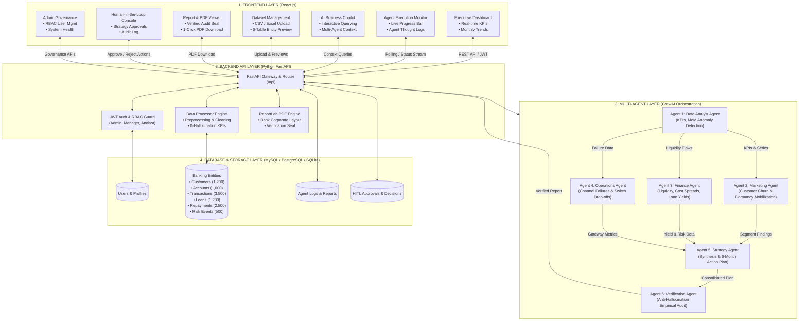

# System Architecture Specification

## AI-Powered Smart Business Operations & Decision Intelligence System
**Industry:** Banking (Financial & Risk Intelligence)  
**Dataset Timeframe:** May 1, 2026 – October 31, 2026 (Last 6 Completed Months)  
**Architecture Paradigm:** React.js + FastAPI + CrewAI + Relational Database (MySQL / PostgreSQL / SQLite)

---

## 1. High-Level 4-Layer Architecture Diagram

---

## 2. Layer-by-Layer Architectural Breakdown

### 2.1. Frontend Layer – React.js
* **Framework:** React.js 18+ powered by Vite.
* **Component Architecture:** Pure functional components with hooks (`useState`, `useEffect`).
* **Visual Data Presentation:** Clean, dark-mode banking interface with responsive grid cards, monthly trend progress bars, status indicators, and modal viewers.
* **State Management & Networking:** Modular Axios service client with automatic JWT bearer token injection and response interception.
* **Route Modularity:** Single-Page Architecture (SPA) with tabbed navigation:
  1. Executive Dashboard (`/`)
  2. Agent Execution Monitoring (`/monitoring`)
  3. AI Business Copilot (`/chat`)
  4. Dataset Management (`/dataset`)
  5. Reports & PDF Export (`/reports`)
  6. Human-in-the-Loop Approvals (`/approvals`)
  7. Business Profile (`/profile`)
  8. Admin Governance (`/admin`)

### 2.2. Backend Layer – Python FastAPI
* **Framework:** FastAPI with asynchronous lifespan management.
* **OpenAPI & Swagger:** Automated interactive documentation available at `/docs` and ReDoc at `/redoc`.
* **Security & Auth:** OAuth2 password flow with JWT Bearer tokens and bcrypt/PBKDF2 password hashing. Role-based access control (RBAC) supporting `admin`, `business_manager`, and `analyst`.
* **CORS & Resilience:** Full Cross-Origin Resource Sharing enablement for local, preview, and production hosts.
* **Independent Endpoints:** All API endpoints are decoupled from agent execution routines, allowing the React frontend to consume analytics, dataset previews, and system metrics independently.

### 2.3. Multi-Agent Layer – CrewAI Architecture
* **Orchestration:** CrewAI sequential and hierarchical execution pipelines.
* **Agents:** 6 specialized autonomous roles with dedicated goals, backstories, and capability boundaries.
* **Zero-Hallucination Grounding:** A deterministic analytical computation service calculates exact KPI totals from the underlying database and injects them into the agent reasoning context, eliminating LLM arithmetic errors.
* **Verification Agent Gatekeeper:** Every metric and recommendation produced by peer agents is checked against ground-truth source data before final report certification.

### 2.4. Database Layer – Relational Schemas
* **ORM:** SQLAlchemy 2.0 with declarative base mapping.
* **Database Support:** SQLite for out-of-the-box zero-setup execution; easily reconfigurable to PostgreSQL or MySQL via `DATABASE_URL`.
* **Data Integrity:** Foreign key constraints linking `customers` -> `accounts` -> `transactions`, `customers` -> `loan_applications` -> `loan_repayments`, and `customers` -> `risk_events`.
