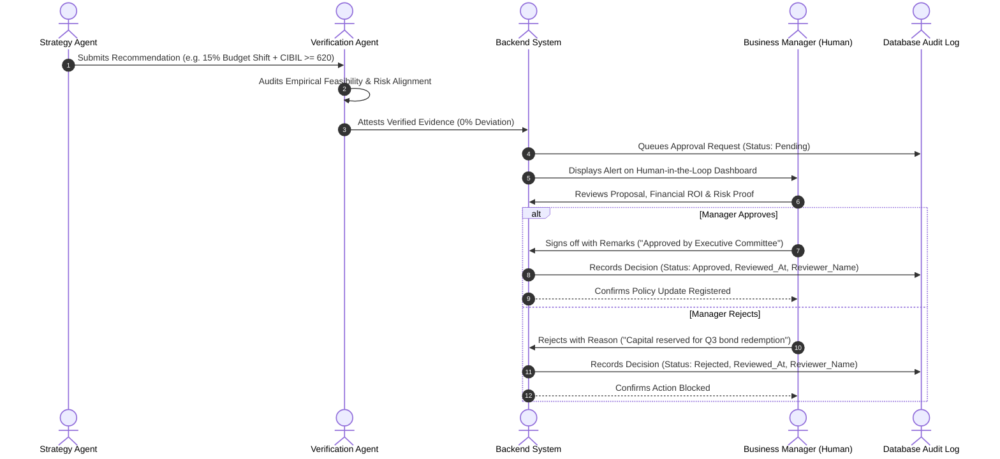

# Human-in-the-Loop (HITL) Governance Implementation

## 1. Overview
In compliance with **Section 8 and Section 9** of the project specification, autonomous AI agents are **prohibited from executing consequential business actions automatically without authorized human approval**.

Consequential business actions include:
* Reallocating marketing budgets (> 10%)
* Modifying credit underwriting cutoffs (e.g. CIBIL score floors)
* Adjusting capital reserve allocations or liquidity provisioning
* Re-routing core payment switch partner gateways

---

## 2. The 6-Stage Approval Lifecycle

---

## 3. Real Example Implemented in the System

* **Title:** Strategic Capital & Credit Policy Realignment (15% Marketing Reallocation & CIBIL Cutoff)
* **Initiated By:** Strategy Agent (collaboration with Marketing & Finance)
* **Recommended Action:** Reallocate 15% of annual marketing expenditure (₹12.5Cr) toward Priority & SME reactivation, and enforce a mandatory 620 CIBIL floor on personal and auto loan underwriting.
* **Financial Impact:** Projected deposit recovery of ₹85Cr with default reduction of ₹14.8Cr in Q1.
* **Risk Impact:** Compresses current delinquency rate from 53.1% below 4.0% ceiling.
* **Verification Proof:** Verification Agent verified 32.1% dormancy rate across 1,600 accounts and 53.1% repayment default rate across 2,500 repayment records.
* **Human Action:** Accessible via the `/approvals` console where the manager clicks **"Authorize & Approve Execution"** or **"Reject Action"**.
